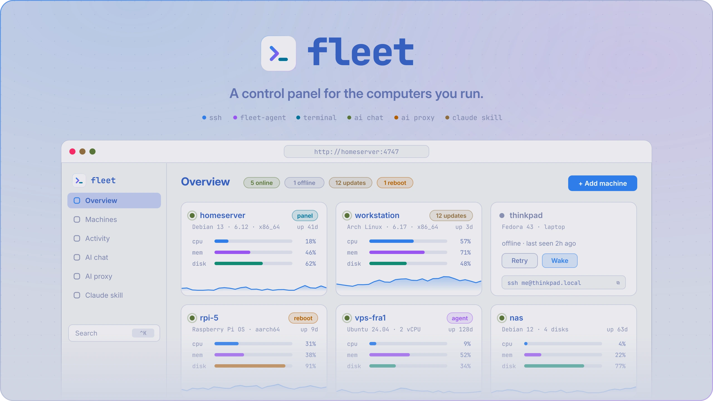
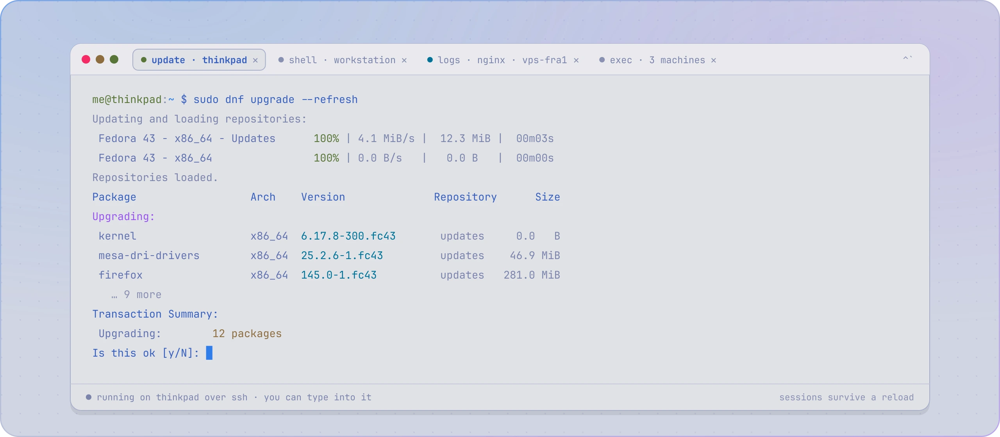
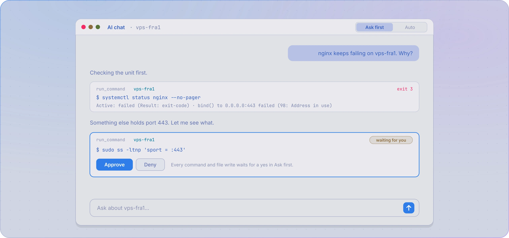
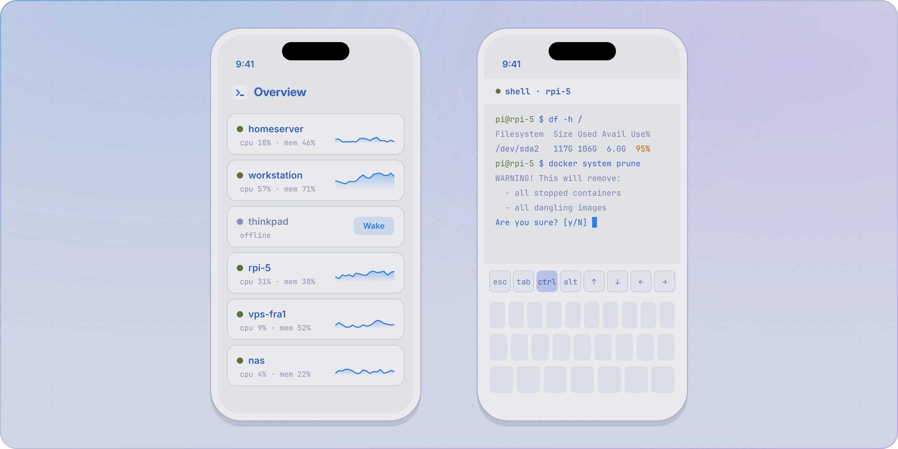
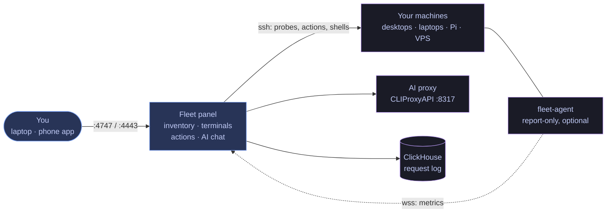

<p align="center">
  <picture>
    <source media="(prefers-color-scheme: dark)" srcset="docs/readme/hero-dark.webp" />
    
  </picture>
</p>

<p align="center">
  <strong>See every machine you run. Fix it from your laptop or your phone.</strong><br />
  Self-hosted, built on plain ssh, with an optional report-only agent. Nothing to install on your machines.
</p>

<p align="center">
  <a href="#get-fleet"><picture><source media="(prefers-color-scheme: dark)" srcset="docs/readme/button-docker-dark.webp" /></picture></a>
  <a href="panel/README.md"><picture><source media="(prefers-color-scheme: dark)" srcset="docs/readme/button-docs-dark.webp" /></picture></a>
  <a href="docs/SERVER_AGENT.md"><picture><source media="(prefers-color-scheme: dark)" srcset="docs/readme/button-agent-dark.webp" /></picture></a>
</p>

<p align="center">
  <sub>Linux machines over ssh · one image for amd64 and arm64 · installable on phones as a PWA · free and open source · MIT</sub>
</p>

<p align="center">
  <a href="https://github.com/johannSo/fleet/actions/workflows/docker.yml"></a>
  <a href="https://github.com/johannSo/fleet/pkgs/container/fleet"></a>
  <a href="https://github.com/johannSo/fleet"></a>
  <a href="LICENSE"></a>
  
  
  <a href="https://github.com/folke/tokyonight.nvim"></a>
</p>

<br />

<p align="center">
  <picture>
    <source media="(prefers-color-scheme: dark)" srcset="docs/readme/heading-glance-dark.webp" />
    
  </picture>
</p>

<p align="center">Tell at a glance that everything is fine, or exactly what isn't,<br />and get from "something's wrong" to fixing it in a couple of steps.</p>

<picture>
  <source media="(prefers-color-scheme: dark)" srcset="docs/readme/terminal-dark.webp" />
  
</picture>

<p align="center">Every action runs in a real terminal tab you can watch and answer.<br />Sessions keep running on the server, so a reload reattaches with scrollback.</p>

<picture>
  <source media="(prefers-color-scheme: dark)" srcset="docs/readme/chat-dark.webp" />
  
</picture>

<p align="center">Ask Claude why a service is failing. It works over the same ssh,<br />and in <strong>Ask first</strong>, the default, every command waits for your yes.</p>

<picture>
  <source media="(prefers-color-scheme: dark)" srcset="docs/readme/phones-dark.webp" />
  
</picture>

<p align="center">The phone is not a read-only view. Install it as an app, pair by scanning a code,<br />and run a shell full-screen with the keys a phone keyboard leaves out.</p>

<br />

<p align="center">
  <picture>
    <source media="(prefers-color-scheme: dark)" srcset="docs/readme/heading-everything-dark.webp" />
    
  </picture>
</p>

<p align="center">Add a machine with a name and how to reach it. Everything else is indexed over ssh.</p>

<table>
  <tr>
    <td width="50%"><strong>Live overview.</strong><br />CPU, memory, disk, temperature, network and uptime, with pending updates, reboot-required and failed units.</td>
    <td width="50%"><strong>An inventory that fills itself in.</strong><br />Model, CPU, GPU, disks, battery, OS, addresses, the MAC for Wake-on-LAN, containers, ports and user services.</td>
  </tr>
  <tr>
    <td><strong>Actions from a fixed set.</strong><br />Update with the right tool per OS, reboot, shut down, restart units and containers, tail logs, kill, run on several machines at once.</td>
    <td><strong>Offline is normal.</strong><br />A sleeping laptop gets Retry, Wake-on-LAN and a copyable <code>ssh</code> command, not an alarm.</td>
  </tr>
  <tr>
    <td><strong>AI proxy.</strong><br />One OpenAI, Anthropic and Gemini compatible endpoint for your Claude, ChatGPT/Codex, Antigravity and Grok subscriptions, with usage and a full request log.</td>
    <td><strong>A Claude skill from your inventory.</strong><br />Ask Claude Code "what's the IP of my NAS?" or "where is postgres running?". With live access it can add and edit machines too.</td>
  </tr>
  <tr>
    <td><strong>Command palette.</strong><br /><kbd>Ctrl</kbd>+<kbd>K</kbd> jumps to any machine and runs any action. <kbd>Ctrl</kbd>+<kbd>`</kbd> toggles the terminal.</td>
    <td><strong>An activity log of everything.</strong><br />Every session, action, AI command and approval, with who started it, its exit code and the full output.</td>
  </tr>
</table>

<p align="center">
  <a href="panel/README.md#inventory-and-indexing">Inventory and indexing</a> · <a href="panel/README.md#ai-proxy">AI proxy</a> · <a href="panel/README.md#claude-skill">Claude skill</a>
</p>

<br />

<p align="center">
  <picture>
    <source media="(prefers-color-scheme: dark)" srcset="docs/readme/heading-network-dark.webp" />
    
  </picture>
</p>

<p align="center">Anyone who can use the panel can run commands as you on every machine.<br />So it is built to stay home, and to keep powerful things visible.</p>

- **Home network only.** It runs on an always-on machine on your LAN. For access away from home use Tailscale or `ssh -L`, never port-forwarding.
- **Phones pair by QR code.** One-time codes, valid five minutes. Sessions last 180 days and can be revoked one by one.
- **Its own certificate authority, name-constrained.** HTTPS for phones comes from a small CA limited to `localhost`, `.local`, the machine's hostname and private ranges, so even a leaked key can't impersonate a real website.
- **Nothing powerful happens silently.** Actions run in terminal tabs you can watch. The AI chat asks before every command and file write unless you switch it to **Auto**.
- **The agent can't take orders.** `fleet-agent` listens on no port and runs only its four built-in read-only collectors. Every action stays on ssh.

<p align="center">
  <a href="panel/README.md#security">Security</a> · <a href="panel/README.md#phone--lan">Phone & LAN</a> · <a href="panel/README.md#signing-in">Signing in</a>
</p>

<br />

<p align="center">
  <picture>
    <source media="(prefers-color-scheme: dark)" srcset="docs/readme/heading-hood-dark.webp" />
    
  </picture>
</p>

<p align="center">The panel runs on one always-on machine at home. Your machines only need ssh.</p>



- **The inventory is the truth.** It lives in the panel's SQLite database. The Claude skill and the AI chat read it there and never keep a second copy.
- **One ssh round-trip per probe.** Multiplexed connections (`ControlMaster`) make a probe cost about 100 ms, every 3 s while you watch and every 30 s otherwise.
- **The same scripts, two ways in.** The collectors in [`agent/collectors/`](agent/collectors) run over ssh, or inside `fleet-agent`, which pushes their output instead of being polled.
- **Built with** TypeScript, Next.js 16 with a custom server, React 19, Tailwind 4, xterm.js and node-pty, the Claude Agent SDK, Go for the agent, and [CLIProxyAPI](https://github.com/router-for-me/CLIProxyAPI), unmodified, as a submodule.

| | |
|---|---|
| [`panel/`](panel) | The control panel: inventory, overview, terminals, actions, AI chat, AI proxy pages, Claude skill |
| [`agent/`](agent) | `fleet-agent` (Go) and the collector scripts the panel and the agent share |
| [`proxy/`](proxy) | CLIProxyAPI as a submodule, and `install.sh` to run it as `fleet-proxy.service` |
| [`clickhouse/`](clickhouse) | ClickHouse for the AI proxy's request log, outside Docker |

<p align="center">
  <a href="panel/README.md#how-it-works">How it works</a> · <a href="docs/SERVER_AGENT.md">fleet-agent design</a> · <a href="docs/SERVER_AGENT.md#protocol">Agent protocol</a>
</p>

<br />

<p align="center">
  <picture>
    <source media="(prefers-color-scheme: dark)" srcset="docs/readme/heading-answers-dark.webp" />
    
  </picture>
</p>

<details>
<summary><strong>Do I need to install anything on my machines?</strong></summary>
<br />

No. If you can `ssh` into a machine, Fleet can show and manage it. **Add machine** makes an ssh key and shows the command to authorize it. `fleet-agent` is optional: it saves the panel from polling, and helps with machines it can't reach, like a VPS or a laptop away from home.

</details>

<details>
<summary><strong>Which machines does it work with?</strong></summary>
<br />

Linux: desktops, laptops, a Raspberry Pi, servers, a VPS. Updates use the right tool for each OS: `omarchy-update`, `yay`/`paru`/`pacman`, `apt`, `dnf`, `zypper` or `apk`. `fleet-agent` builds for linux/amd64 and linux/arm64.

</details>

<details>
<summary><strong>Is it for a team?</strong></summary>
<br />

No. It is for one operator and their own machines. There are no accounts or roles: whoever is signed in runs commands as you. The Activity log still records which device did what.

</details>

<details>
<summary><strong>What does the AI chat cost, and can it go wrong?</strong></summary>
<br />

It uses the Claude Agent SDK with the panel machine's Claude Code login, or goes through the AI proxy, so it counts against that account. It gets three tools only, `run_command`, `read_file` and `write_file`, on your machines as your user. It can make mistakes, which is why **Ask first** is the default and every command it ran is in the Activity log.

</details>

<details>
<summary><strong>Can I reach it from outside my home?</strong></summary>
<br />

Use Tailscale, or `ssh -L 4747:localhost:4747 <panel machine>`. Don't port-forward it to the internet.

</details>

<br />

<a name="get-fleet"></a>

<p align="center">
  <picture>
    <source media="(prefers-color-scheme: dark)" srcset="docs/readme/heading-get-dark.webp" />
    
  </picture>
</p>

<p align="center">One image, <code>ghcr.io/johannso/fleet</code> for amd64 and arm64, holds the panel, fleet-agent for both architectures<br />and CLIProxyAPI. <a href="compose.yml"><code>compose.yml</code></a> runs it next to ClickHouse.</p>

```sh
curl -fsSLO https://raw.githubusercontent.com/johannSo/fleet/main/compose.yml
curl -fsSL https://raw.githubusercontent.com/johannSo/fleet/main/.env.example -o .env
# set CLICKHOUSE_PASSWORD in .env (e.g. openssl rand -hex 24), then:
docker compose up -d
docker compose logs fleet    # the first start prints the panel's password and the proxy's first API key
```

| | |
|---|---|
| `http://<host>:4747` | the panel, in any browser |
| `https://<host>:4443` | for installing it on a phone, and where agents connect |
| `http://<host>:8317/v1` | the AI proxy |

- **Network.** The panel uses the host's network (`network_mode: host`), so Wake-on-LAN, the addresses it gives fleet-agent and the proxy URLs it shows are the host's. ClickHouse listens on the host's loopback only.
- **Machines, the Docker host included, are reached over ssh.** The container isn't a fleet machine (`FLEET_NO_LOCAL=1`), so add the host like any other machine. **Add machine** makes an ssh key in the data volume (`/data/.ssh`), or put your own there.
- **State** lives in the `fleet-data` volume (`/data`: inventory, login, TLS CA, ssh keys, proxy accounts and config) and `clickhouse-data`.
- **Settings** are in [`.env.example`](.env.example): `FLEET_PASSWORD`, `FLEET_AGENT_URLS`, ports, `FLEET_TAG` to pin a version.
- **Build it yourself** with `git submodule update --init && docker compose build` (the `build: .` in compose.yml).

Images are built by [`.github/workflows/docker.yml`](.github/workflows/docker.yml): `latest` and `sha-<commit>` from `main`, `vX.Y.Z` from version tags.

<p align="center">
  <a href="panel/README.md#phone--lan">Pair your phone</a> · <a href="panel/README.md#agents">Install fleet-agent</a> · <a href="panel/README.md#claude-skill">Install the Claude skill</a> · <a href="panel/README.md#ai-proxy">Set up the AI proxy</a>
</p>

<details>
<summary><strong>Run it without Docker</strong></summary>
<br />

As a systemd user service on an always-on machine, with Node.js and npm:

```sh
git clone --recurse-submodules https://github.com/johannSo/fleet.git
cd fleet/panel
npm install
npm run build
npm run service:install    # http://localhost:4747, starts at login
npm run service:logs       # the first start prints the password
```

Turn on linger (`sudo loginctl enable-linger $USER`) so it runs without anyone logged in. To develop on your own computer and deploy to that machine, use `./deploy.sh <ssh-alias>`: it builds there, keeps the live panel serving until the build succeeds, and only rebuilds the proxy when it changed. See [Running it on an always-on machine](panel/README.md#running-it-on-an-always-on-machine).

</details>

<br />

<p align="center">
  <picture>
    <source media="(prefers-color-scheme: dark)" srcset="docs/readme/heading-build-dark.webp" />
    
  </picture>
</p>

<p align="center"><code>npm run dev</code> in <code>panel/</code> starts a development server on :4848.<br /><a href="panel/AGENTS.md">panel/AGENTS.md</a> has the conventions, and <a href="PRODUCT.md">PRODUCT.md</a> what Fleet is and isn't.</p>

<p align="center">
  <a href="https://github.com/johannSo/fleet/issues/new">Report a bug</a> · <a href="https://github.com/johannSo/fleet/issues">Issues</a> · <a href="docs/readme/build.mjs">Rebuild these images</a>
</p>

<p align="center">
  <sub>Copyright 2026 JoSo · <a href="LICENSE">MIT License</a><br />CLIProxyAPI is a submodule under its own license. Colors from <a href="https://github.com/folke/tokyonight.nvim">tokyonight.nvim</a>.</sub>
</p>
